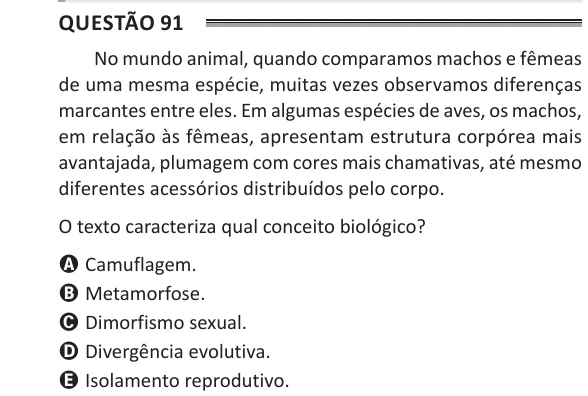

Texto extraído (pode conter ruído)

Questão 91  
No mundo animal, quando comparamos machos e fêmeas  
de uma mesma espécie, muitas vezes observamos diferenças  
marcantes entre eles. Em algumas espécies de aves, os machos,  
em relação às fêmeas, apresentam estrutura corpórea mais  
avantajada, plumagem com cores mais chamativas, até mesmo  
diferentes acessórios distribuídos pelo corpo.  
O texto caracteriza qual conceito biológico?  
A Camuflagem.  
B Metamorfose.  
C Dimorfismo sexual.  
D Divergência evolutiva.  
E Isolamento reprodutivo.

