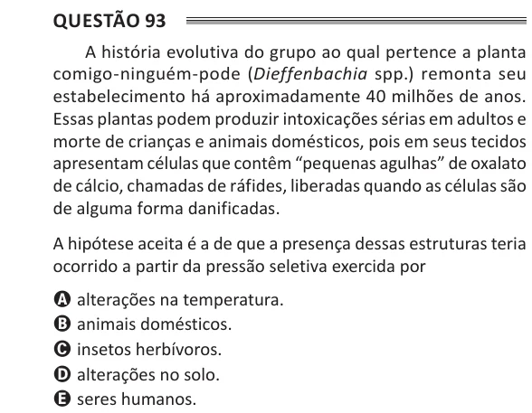

Texto extraído (pode conter ruído)

Questão 93  
A história evolutiva do grupo ao qual pertence a planta  
comigo-ninguém-pode (Dieffenbachia spp.) remonta seu  
estabelecimento há aproximadamente 40 milhões de anos.  
Essas plantas podem produzir intoxicações sérias em adultos e  
morte de crianças e animais domésticos, pois em seus tecidos  
apresentam células que contêm “pequenas agulhas” de oxalato  
de cálcio, chamadas de ráfides, liberadas quando as células são  
de alguma forma danificadas.  
A hipótese aceita é a de que a presença dessas estruturas teria  
ocorrido a partir da pressão seletiva exercida por  
A alterações na temperatura.  
B animais domésticos.  
C insetos herbívoros.  
D alterações no solo.  
E seres humanos.

