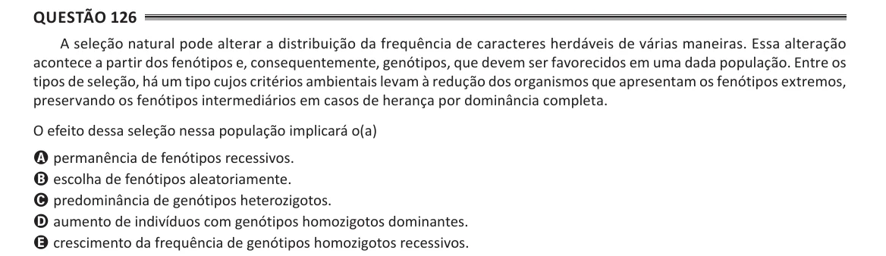

Texto extraído (pode conter ruído)

Questão 126  
A seleção natural pode alterar a distribuição da frequência de caracteres herdáveis de várias maneiras. Essa alteração  
acontece a partir dos fenótipos e, consequentemente, genótipos, que devem ser favorecidos em uma dada população. Entre os  
tipos de seleção, há um tipo cujos critérios ambientais levam à redução dos organismos que apresentam os fenótipos extremos,  
preservando os fenótipos intermediários em casos de herança por dominância completa.  
O efeito dessa seleção nessa população implicará o(a)  
A permanência de fenótipos recessivos.  
B escolha de fenótipos aleatoriamente.  
C predominância de genótipos heterozigotos.  
D aumento de indivíduos com genótipos homozigotos dominantes.  
E crescimento da frequência de genótipos homozigotos recessivos.

