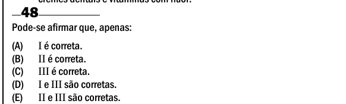

Texto extraído (pode conter ruído)

48  
Pode-se afirmar que, apenas:  
(A)  
I é correta.  
(B)  
II é correta.  
(C)  
III é correta.  
(D)  
I e III são corretas.  
(E)  
II e III são corretas.

