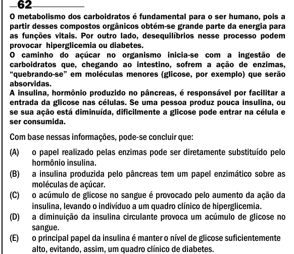

Texto extraído (pode conter ruído)

O metabolismo dos carboidratos é fundamental para o ser humano, pois a  
partir desses compostos orgânicos obtém-se grande parte da energia para  
as funções vitais. Por outro lado, desequilíbrios nesse processo podem  
provocar hiperglicemia ou diabetes.  
O caminho do açúcar no organismo inicia-se com a ingestão de  
carboidratos que, chegando ao intestino, sofrem a ação de enzimas,  
“quebrando-se” em moléculas menores (glicose, por exemplo) que serão  
absorvidas.  
A insulina, hormônio produzido no pâncreas, é responsável por facilitar a  
entrada da glicose nas células. Se uma pessoa produz pouca insulina, ou  
se sua ação está diminuída, dificilmente a glicose pode entrar na célula e  
ser consumida.  
Com base nessas informações, pode-se concluir que:  
(A)  
o papel realizado pelas enzimas pode ser diretamente substituído pelo  
hormônio insulina.  
(B)  
a insulina produzida pelo pâncreas tem um papel enzimático sobre as  
moléculas de açúcar.  
(C)  
o acúmulo de glicose no sangue é provocado pelo aumento da ação da  
insulina, levando o indivíduo a um quadro clínico de hiperglicemia.  
(D)  
a diminuição da insulina circulante provoca um acúmulo de glicose no  
sangue.  
(E)  
o principal papel da insulina é manter o nível de glicose suficientemente  
alto, evitando, assim, um quadro clínico de diabetes.

