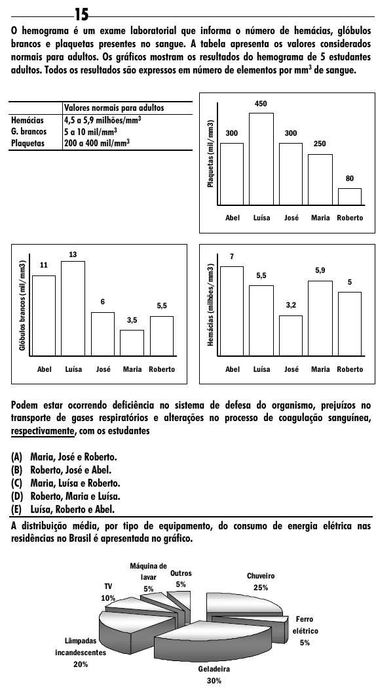

Texto extraído (pode conter ruído)

15  
O hemograma é um exame laboratorial que informa o número de hemácias, glóbulos  
brancos e plaquetas presentes no sangue. A tabela apresenta os valores considerados  
normais para adultos. Os gráficos mostram os resultados do hemograma de 5 estudantes  
adultos. Todos os resultados são expressos em número de elementos por mm 3 de sangue.  
450  
Valores normais para adultos  
Hemácias  
4,5 a 5,9 milhões/mm 3  
Plaquetas (mil/mm3)  
G. brancos  
5 a 10 mil/mm 3  
300  
300  
Plaquetas  
200 a 400 mil/mm 3  
250  
80  
Abel  
Luísa  
José  
Maria Roberto  
13  
7  
Glóbulos brancos (mil/mm3)  
11  
Hemácias (milhões/mm3)  
5,9  
5,5  
5  
6  
5,5  
3,2  
3,5  
Abel  
Luísa  
José  
Maria Roberto  
Abel  
Luísa  
José  
Maria Roberto  
Podem estar ocorrendo deficiência no sistema de defesa do organismo, prejuízos no  
transporte de gases respiratórios e alterações no processo de coagulação sanguínea,  
respectivamente, com os estudantes  
(A) Maria, José e Roberto.  
(B) Roberto, José e Abel.  
(C) Maria, Luísa e Roberto.  
(D) Roberto, Maria e Luísa.  
(E) Luísa, Roberto e Abel.  
A distribuição média, por tipo de equipamento, do consumo de energia elétrica nas  
residências no Brasil é apresentada no gráfico.  
Máquina de  
Outros  
Chuveiro  
lavar  
5%  
TV  
5%  
25%  
10%  
Ferro  
elétrico  
Lâmpadas  
5%  
incandescentes  
20%  
Geladeira  
30%

