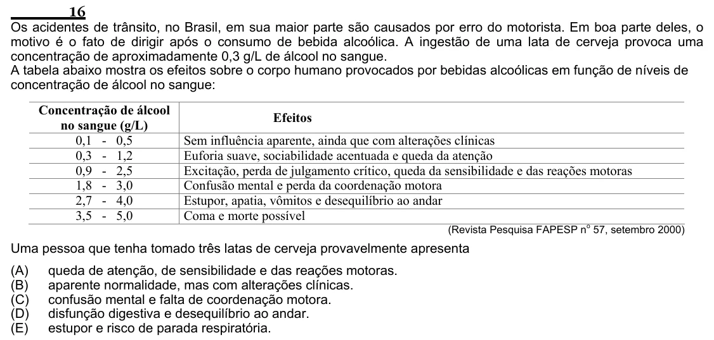

Texto extraído (pode conter ruído)

16  
Os acidentes de trânsito, no Brasil, em sua maior parte são causados por erro do motorista. Em boa parte deles, o  
motivo é o fato de dirigir após o consumo de bebida alcoólica. A ingestão de uma lata de cerveja provoca uma  
concentração de aproximadamente 0,3 g/L de álcool no sangue.  
A tabela abaixo mostra os efeitos sobre o corpo humano provocados por bebidas alcoólicas em função de níveis de  
concentração de álcool no sangue:  
Concentração de álcool  
Efeitos  
no sangue (g/L)  
0,1 - 0,5  
Sem influência aparente, ainda que com alterações clínicas  
0,3 - 1,2  
Euforia suave, sociabilidade acentuada e queda da atenção  
0,9 - 2,5  
Excitação, perda de julgamento crítico, queda da sensibilidade e das reações motoras  
1,8 - 3,0  
Confusão mental e perda da coordenação motora  
2,7 - 4,0  
Estupor, apatia, vômitos e desequilíbrio ao andar  
3,5 - 5,0  
Coma e morte possível  
(Revista Pesquisa FAPESP n 57, setembro 2000)  
o  
Uma pessoa que tenha tomado três latas de cerveja provavelmente apresenta  
(A)  
queda de atenção, de sensibilidade e das reações motoras.  
(B)  
aparente normalidade, mas com alterações clínicas.  
(C)  
confusão mental e falta de coordenação motora.  
(D)  
disfunção digestiva e desequilíbrio ao andar.  
(E)  
estupor e risco de parada respiratória.

