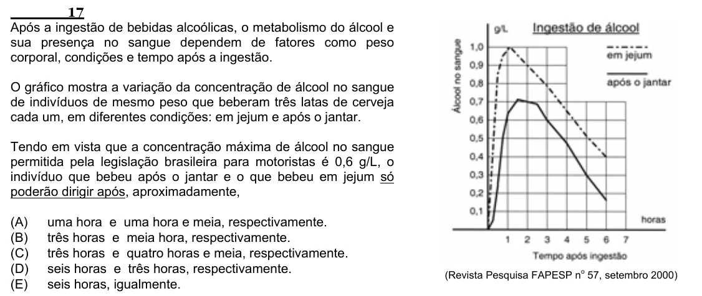

Texto extraído (pode conter ruído)

17  
Após a ingestão de bebidas alcoólicas, o metabolismo do álcool e  
sua presença no sangue dependem de fatores como peso  
corporal, condições e tempo após a ingestão.  
O gráfico mostra a variação da concentração de álcool no sangue  
de indivíduos de mesmo peso que beberam três latas de cerveja  
cada um, em diferentes condições: em jejum e após o jantar.  
Tendo em vista que a concentração máxima de álcool no sangue  
permitida pela legislação brasileira para motoristas é 0,6 g/L, o  
indivíduo que bebeu após o jantar e o que bebeu em jejum só  
poderão dirigir após, aproximadamente,  
(A)  
uma hora e uma hora e meia, respectivamente.  
(B)  
três horas e meia hora, respectivamente.  
(C)  
três horas e quatro horas e meia, respectivamente.  
(D)  
seis horas e três horas, respectivamente.  
o  
(Revista Pesquisa FAPESP n 57, setembro 2000)  
(E)  
seis horas, igualmente.

