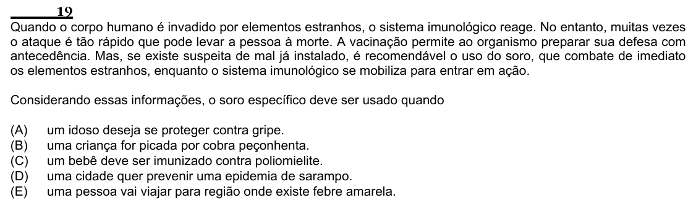

Texto extraído (pode conter ruído)

19  
Quando o corpo humano é invadido por elementos estranhos, o sistema imunológico reage. No entanto, muitas vezes  
o ataque é tão rápido que pode levar a pessoa à morte. A vacinação permite ao organismo preparar sua defesa com  
antecedência. Mas, se existe suspeita de mal já instalado, é recomendável o uso do soro, que combate de imediato  
os elementos estranhos, enquanto o sistema imunológico se mobiliza para entrar em ação.  
Considerando essas informações, o soro específico deve ser usado quando  
(A)  
um idoso deseja se proteger contra gripe.  
(B)  
uma criança for picada por cobra peçonhenta.  
(C)  
um bebê deve ser imunizado contra poliomielite.  
(D)  
uma cidade quer prevenir uma epidemia de sarampo.  
(E)  
uma pessoa vai viajar para região onde existe febre amarela.

