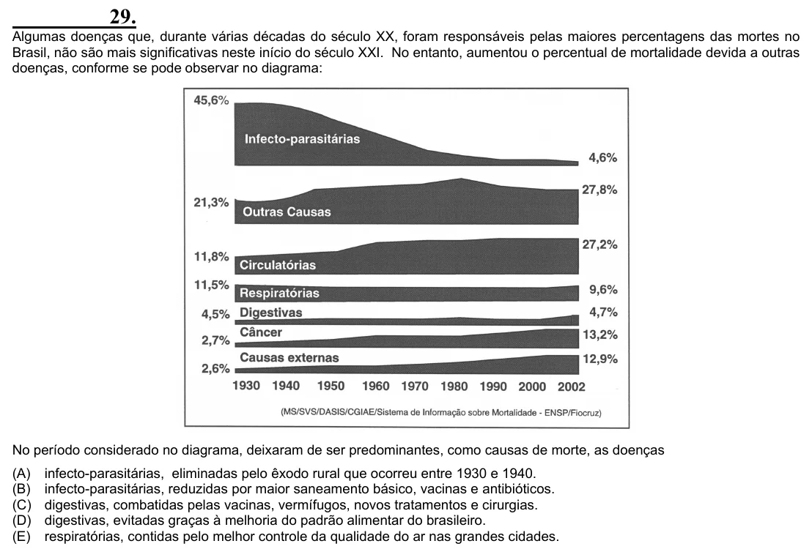

Texto extraído (pode conter ruído)

29.  
Algumas doenças que, durante várias décadas do século XX, foram responsáveis pelas maiores percentagens das mortes no  
Brasil, não são mais significativas neste início do século XXI. No entanto, aumentou o percentual de mortalidade devida a outras  
doenças, conforme se pode observar no diagrama:  
No período considerado no diagrama, deixaram de ser predominantes, como causas de morte, as doenças  
(A)  
infecto-parasitárias, eliminadas pelo êxodo rural que ocorreu entre 1930 e 1940.  
(B)  
infecto-parasitárias, reduzidas por maior saneamento básico, vacinas e antibióticos.  
(C)  
digestivas, combatidas pelas vacinas, vermífugos, novos tratamentos e cirurgias.  
(D)  
digestivas, evitadas graças à melhoria do padrão alimentar do brasileiro.  
(E)  
respiratórias, contidas pelo melhor controle da qualidade do ar nas grandes cidades.

