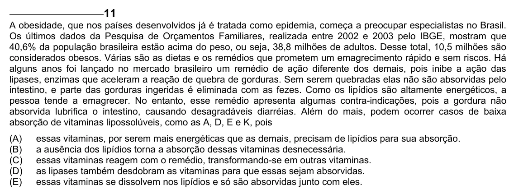

Texto extraído (pode conter ruído)

11  
A obesidade, que nos países desenvolvidos já é tratada como epidemia, começa a preocupar especialistas no Brasil.  
Os últimos dados da Pesquisa de Orçamentos Familiares, realizada entre 2002 e 2003 pelo IBGE, mostram que  
40,6% da população brasileira estão acima do peso, ou seja, 38,8 milhões de adultos. Desse total, 10,5 milhões são  
considerados obesos. Várias são as dietas e os remédios que prometem um emagrecimento rápido e sem riscos. Há  
alguns anos foi lançado no mercado brasileiro um remédio de ação diferente dos demais, pois inibe a ação das  
lipases, enzimas que aceleram a reação de quebra de gorduras. Sem serem quebradas elas não são absorvidas pelo  
intestino, e parte das gorduras ingeridas é eliminada com as fezes. Como os lipídios são altamente energéticos, a  
pessoa tende a emagrecer. No entanto, esse remédio apresenta algumas contra-indicações, pois a gordura não  
absorvida lubrifica o intestino, causando desagradáveis diarréias. Além do mais, podem ocorrer casos de baixa  
absorção de vitaminas lipossolúveis, como as A, D, E e K, pois  
(A)  
essas vitaminas, por serem mais energéticas que as demais, precisam de lipídios para sua absorção.  
(B)  
a ausência dos lipídios torna a absorção dessas vitaminas desnecessária.  
(C)  
essas vitaminas reagem com o remédio, transformando-se em outras vitaminas.  
(D)  
as lipases também desdobram as vitaminas para que essas sejam absorvidas.  
(E)  
essas vitaminas se dissolvem nos lipídios e só são absorvidas junto com eles.

