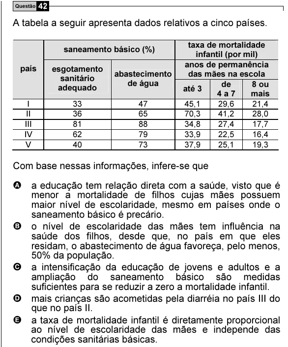

Texto extraído (pode conter ruído)

Questão 42  
A tabela a seguir apresenta dados relativos a cinco países.  
taxa de mortalidade  
saneamento básico (%)  
infantil (por mil)  
anos de permanência  
país  
esgotamento  
abastecimento  
das mães na escola  
sanitário  
de água  
de  
8 ou  
adequado  
até 3  
4 a 7  
mais  
I  
33  
47  
45,1  
29,6  
21,4  
II  
36  
65  
70,3  
41,2  
28,0  
III  
81  
88  
34,8  
27,4  
17,7  
IV  
62  
79  
33,9  
22,5  
16,4  
V  
40  
73  
37,9  
25,1  
19,3  
Com base nessas informações, infere-se que  
A a educação tem relação direta com a saúde, visto que é  
menor a mortalidade de filhos cujas mães possuem  
maior nível de escolaridade, mesmo em países onde o  
saneamento básico é precário.  
B o nível de escolaridade das mães tem influência na  
saúde dos filhos, desde que, no país em que eles  
residam, o abastecimento de água favoreça, pelo menos,  
50% da população.  
C a intensificação da educação de jovens e adultos e a  
ampliação do saneamento básico são medidas  
suficientes para se reduzir a zero a mortalidade infantil.  
D mais crianças são acometidas pela diarréia no país III do  
que no país II.  
E a taxa de mortalidade infantil é diretamente proporcional  
ao nível de escolaridade das mães e independe das  
condições sanitárias básicas.

