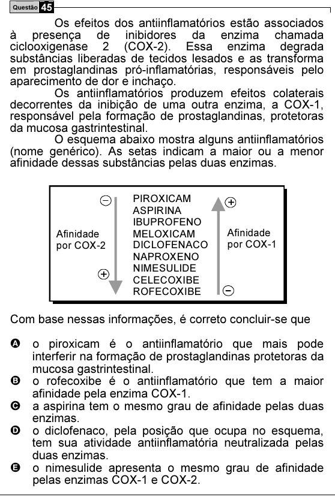

Texto extraído (pode conter ruído)

Questão 45  
Os efeitos dos antiinflamatórios estão associados  
à presença de inibidores da enzima chamada  
ciclooxigenase 2 (COX-2). Essa enzima degrada  
substâncias liberadas de tecidos lesados e as transforma  
em prostaglandinas pró-inflamatórias, responsáveis pelo  
aparecimento de dor e inchaço.  
Os antiinflamatórios produzem efeitos colaterais  
decorrentes da inibição de uma outra enzima, a COX-1,  
responsável pela formação de prostaglandinas, protetoras  
da mucosa gastrintestinal.  
O esquema abaixo mostra alguns antiinflamatórios  
(nome genérico). As setas indicam a maior ou a menor  
afinidade dessas substâncias pelas duas enzimas.  
PIROXICAM  
+  
ASPIRINA  
IBUPROFENO  
Afinidade  
Afinidade  
MELOXICAM  
por COX-2  
DICLOFENACO  
por COX-1  
NAPROXENO  
NIMESULIDE  
+  
CELECOXIBE  
ROFECOXIBE  
Com base nessas informações, é correto concluir-se que  
A o piroxicam é o antiinflamatório que mais pode  
interferir na formação de prostaglandinas protetoras da  
mucosa gastrintestinal.  
B o rofecoxibe é o antiinflamatório que tem a maior  
afinidade pela enzima COX-1.  
C a aspirina tem o mesmo grau de afinidade pelas duas  
enzimas.  
D o diclofenaco, pela posição que ocupa no esquema,  
tem sua atividade antiinflamatória neutralizada pelas  
duas enzimas.  
E o nimesulide apresenta o mesmo grau de afinidade  
pelas enzimas COX-1 e COX-2.

