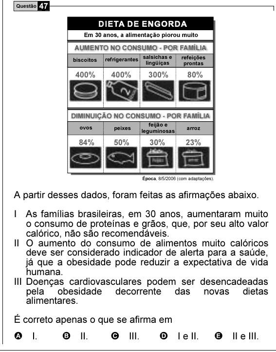

Texto extraído (pode conter ruído)

Questão 47  
Em 30 anos, a alimentação piorou muito  
AUMENTO NO CONSUMO - POR FAMÍLIA  
refrigerantes salsichas e  
refeições  
biscoitos  
lingüiças  
prontas  
400%  
400%  
300%  
80%  
DIMINUIÇÃO NO CONSUMO - POR FAMÍLIA  
feijão e  
ovos  
peixes  
arroz  
leguminosas  
84%  
50%  
30%  
23%  
Época , 8/5/2006 (com adaptações).  
A partir desses dados, foram feitas as afirmações abaixo.  
I As famílias brasileiras, em 30 anos, aumentaram muito  
o consumo de proteínas e grãos, que, por seu alto valor  
calórico, não são recomendáveis.  
II O aumento do consumo de alimentos muito calóricos  
deve ser considerado indicador de alerta para a saúde,  
já que a obesidade pode reduzir a expectativa de vida  
humana.  
III Doenças cardiovasculares podem ser desencadeadas  
pela obesidade decorrente das novas dietas  
alimentares.  
É correto apenas o que se afirma em  
A I.  
B II.  
C III.  
D I e II.  
E II e III.

