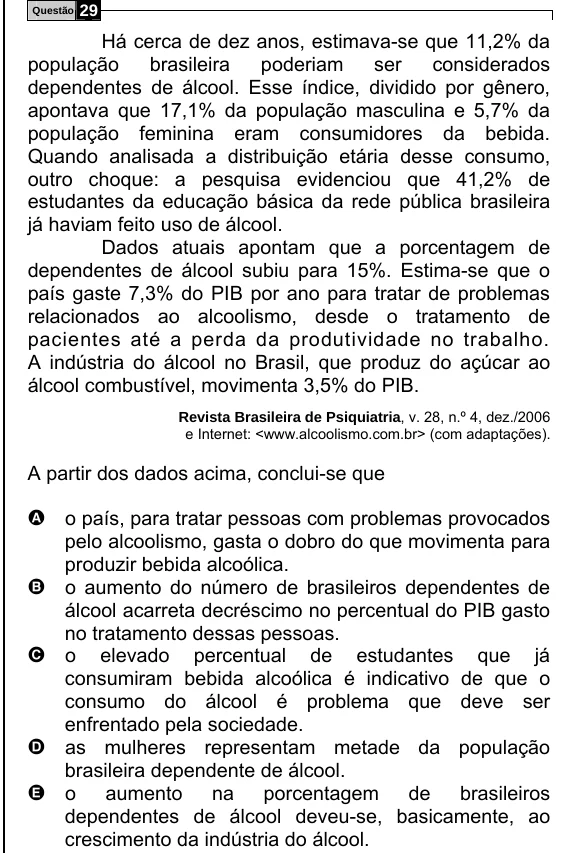

Texto extraído (pode conter ruído)

Questão  
29  
Há cerca de dez anos, estimava-se que 11,2% da  
população  
brasileira  
poderiam  
ser  
considerados  
dependentes de álcool. Esse índice, dividido por gênero,  
apontava que 17,1% da população masculina e 5,7% da  
população feminina eram consumidores da bebida.  
Quando analisada a distribuição etária desse consumo,  
outro choque: a pesquisa evidenciou que 41,2% de  
estudantes da educação básica da rede pública brasileira  
já haviam feito uso de álcool.  
Dados atuais apontam que a porcentagem de  
dependentes de álcool subiu para 15%. Estima-se que o  
país gaste 7,3% do PIB por ano para tratar de problemas  
relacionados ao alcoolismo, desde o tratamento de  
pacientes até a perda da produtividade no trabalho.  
A indústria do álcool no Brasil, que produz do açúcar ao  
álcool combustível, movimenta 3,5% do PIB.  
Revista Brasileira de Psiquiatria, v. 28, n.º 4, dez./2006  
e Internet: <www.alcoolismo.com.br> (com adaptações).  
A partir dos dados acima, conclui-se que  
A o país, para tratar pessoas com problemas provocados  
pelo alcoolismo, gasta o dobro do que movimenta para  
produzir bebida alcoólica.  
B  
o aumento do número de brasileiros dependentes de  
álcool acarreta decréscimo no percentual do PIB gasto  
no tratamento dessas pessoas.  
C  
o elevado percentual de estudantes que já  
consumiram bebida alcoólica é indicativo de que o  
consumo do álcool é problema que deve ser  
enfrentado pela sociedade.  
D  
as mulheres representam metade da população  
brasileira dependente de álcool.  
E  
o aumento na porcentagem de brasileiros  
dependentes de álcool deveu-se, basicamente, ao  
crescimento da indústria do álcool.

