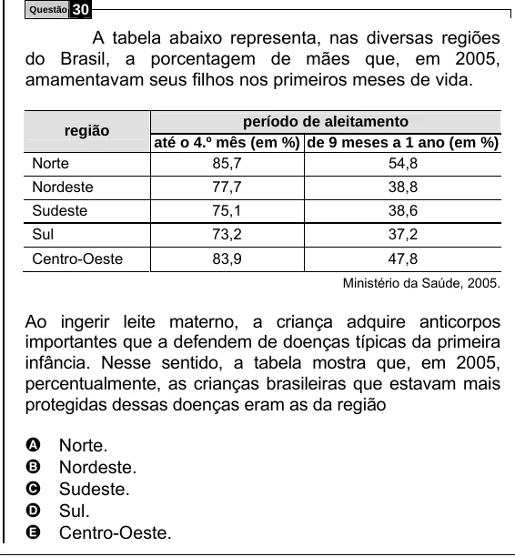

Texto extraído (pode conter ruído)

Questão  
30  
A tabela abaixo representa, nas diversas regiões  
do Brasil, a porcentagem de mães que, em 2005,  
amamentavam seus filhos nos primeiros meses de vida.  
período de aleitamento  
região  
até o 4.º mês (em %) de 9 meses a 1 ano (em %)  
Norte  
85,7  
54,8  
Nordeste  
77,7  
38,8  
Sudeste  
75,1  
38,6  
Sul  
73,2  
37,2  
Centro-Oeste  
83,9  
47,8  
Ministério da Saúde, 2005.  
Ao ingerir leite materno, a criança adquire anticorpos  
importantes que a defendem de doenças típicas da primeira  
infância. Nesse sentido, a tabela mostra que, em 2005,  
percentualmente, as crianças brasileiras que estavam mais  
protegidas dessas doenças eram as da região  
Norte.  
A  
Nordeste.  
B  
Sudeste.  
C  
D  
Sul.  
E  
Centro-Oeste.

