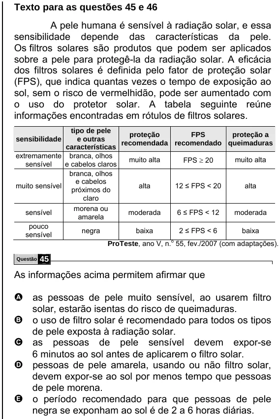

Texto extraído (pode conter ruído)

Texto para as questões 45 e 46  
A pele humana é sensível à radiação solar, e essa  
sensibilidade depende das características da pele.  
Os filtros solares são produtos que podem ser aplicados  
sobre a pele para protegê-la da radiação solar. A eficácia  
dos filtros solares é definida pelo fator de proteção solar  
(FPS), que indica quantas vezes o tempo de exposição ao  
sol, sem o risco de vermelhidão, pode ser aumentado com  
o uso do protetor solar. A tabela seguinte reúne  
informações encontradas em rótulos de filtros solares.  
tipo de pele  
proteção  
FPS  
proteção a  
sensibilidade  
e outras  
recomendada recomendado queimaduras  
características  
extremamente branca, olhos  
muito alta  
FPS ≥ 20  
muito alta  
sensível  
e cabelos claros  
branca, olhos  
e cabelos  
muito sensível  
alta  
12 ≤ FPS < 20  
alta  
próximos do  
claro  
morena ou  
sensível  
moderada  
6 ≤ FPS < 12  
moderada  
amarela  
pouco  
negra  
baixa  
2 ≤ FPS < 6  
baixa  
sensível  
ProTeste, ano V, n. o 55, fev./2007 (com adaptações).  
Questão  
45  
As informações acima permitem afirmar que  
A as pessoas de pele muito sensível, ao usarem filtro  
solar, estarão isentas do risco de queimaduras.  
B o uso de filtro solar é recomendado para todos os tipos  
de pele exposta à radiação solar.  
C as pessoas de pele sensível devem expor-se  
6 minutos ao sol antes de aplicarem o filtro solar.  
D pessoas de pele amarela, usando ou não filtro solar,  
devem expor-se ao sol por menos tempo que pessoas  
de pele morena.  
E o período recomendado para que pessoas de pele  
negra se exponham ao sol é de 2 a 6 horas diárias.

