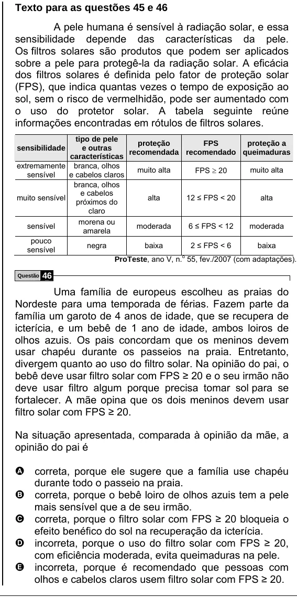

Texto extraído (pode conter ruído)

Texto para as questões 45 e 46  
A pele humana é sensível à radiação solar, e essa  
sensibilidade depende das características da pele.  
Os filtros solares são produtos que podem ser aplicados  
sobre a pele para protegê-la da radiação solar. A eficácia  
dos filtros solares é definida pelo fator de proteção solar  
(FPS), que indica quantas vezes o tempo de exposição ao  
sol, sem o risco de vermelhidão, pode ser aumentado com  
o uso do protetor solar. A tabela seguinte reúne  
informações encontradas em rótulos de filtros solares.  
tipo de pele  
proteção  
FPS  
proteção a  
sensibilidade  
e outras  
recomendada recomendado queimaduras  
características  
extremamente branca, olhos  
muito alta  
FPS ≥ 20  
muito alta  
sensível  
e cabelos claros  
branca, olhos  
e cabelos  
muito sensível  
alta  
12 ≤ FPS < 20  
alta  
próximos do  
claro  
morena ou  
sensível  
moderada  
6 ≤ FPS < 12  
moderada  
amarela  
pouco  
negra  
baixa  
2 ≤ FPS < 6  
baixa  
sensível  
ProTeste, ano V, n. o 55, fev./2007 (com adaptações).  
Questão  
46  
Uma família de europeus escolheu as praias do  
Nordeste para uma temporada de férias. Fazem parte da  
família um garoto de 4 anos de idade, que se recupera de  
icterícia, e um bebê de 1 ano de idade, ambos loiros de  
olhos azuis. Os pais concordam que os meninos devem  
usar chapéu durante os passeios na praia. Entretanto,  
divergem quanto ao uso do filtro solar. Na opinião do pai, o  
bebê deve usar filtro solar com FPS ≥ 20 e o seu irmão não  
deve usar filtro algum porque precisa tomar sol para se  
fortalecer. A mãe opina que os dois meninos devem usar  
filtro solar com FPS ≥ 20.  
Na situação apresentada, comparada à opinião da mãe, a  
opinião do pai é  
A correta, porque ele sugere que a família use chapéu  
durante todo o passeio na praia.  
B correta, porque o bebê loiro de olhos azuis tem a pele  
mais sensível que a de seu irmão.  
C correta, porque o filtro solar com FPS ≥ 20 bloqueia o  
efeito benéfico do sol na recuperação da icterícia.  
D incorreta, porque o uso do filtro solar com FPS ≥ 20,  
com eficiência moderada, evita queimaduras na pele.  
E incorreta, porque é recomendado que pessoas com  
olhos e cabelos claros usem filtro solar com FPS ≥ 20.

