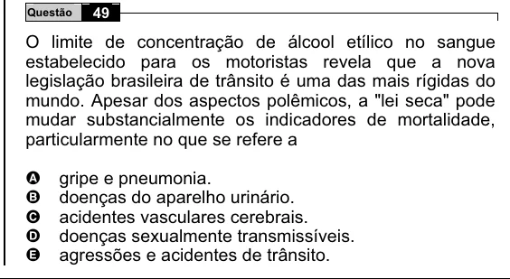

Texto extraído (pode conter ruído)

Questão  
49  
O limite de concentração de álcool etílico no sangue  
estabelecido para os motoristas revela que a nova  
legislação brasileira de trânsito é uma das mais rígidas do  
mundo. Apesar dos aspectos polêmicos, a "lei seca" pode  
mudar substancialmente os indicadores de mortalidade,  
particularmente no que se refere a  
A  
gripe e pneumonia.  
doenças do aparelho urinário.  
B  
C  
acidentes vasculares cerebrais.  
doenças sexualmente transmissíveis.  
D  
agressões e acidentes de trânsito.  
E

