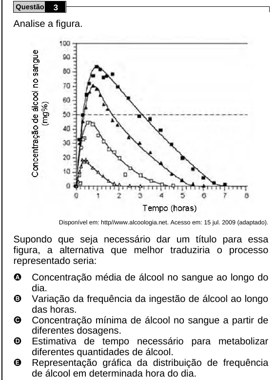

Texto extraído (pode conter ruído)

Questão  
3  
Analise a figura.  
Disponível em: http//www.alcoologia.net. Acesso em: 15 jul. 2009 (adaptado).  
Supondo que seja necessário dar um título para essa  
figura, a alternativa que melhor traduziria o processo  
representado seria:  
A  
Concentração média de álcool no sangue ao longo do  
dia.  
B  
Variação da frequência da ingestão de álcool ao longo  
das horas.  
C  
Concentração mínima de álcool no sangue a partir de  
diferentes dosagens.  
D  
Estimativa de tempo necessário para metabolizar  
diferentes quantidades de álcool.  
E  
Representação gráfica da distribuição de frequência  
de álcool em determinada hora do dia.

