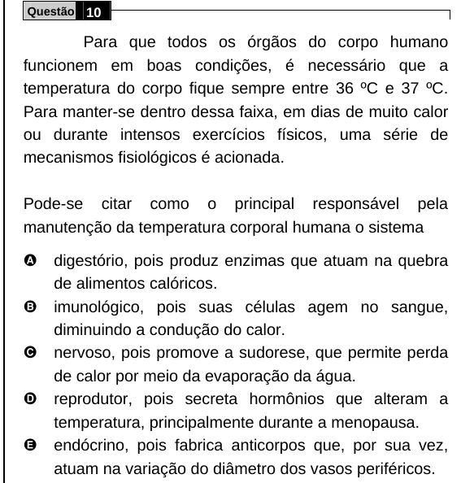

Texto extraído (pode conter ruído)

Questão 10  
Para que todos os órgãos do corpo humano  
funcionem em boas condições, é necessário que a  
temperatura do corpo fique sempre entre 36 ºC e 37 ºC.  
Para manter-se dentro dessa faixa, em dias de muito calor  
ou durante intensos exercícios físicos, uma série de  
mecanismos fisiológicos é acionada.  
Pode-se citar como o principal responsável pela  
manutenção da temperatura corporal humana o sistema  
A  
digestório, pois produz enzimas que atuam na quebra  
de alimentos calóricos.  
B  
imunológico, pois suas células agem no sangue,  
diminuindo a condução do calor.  
C  
nervoso, pois promove a sudorese, que permite perda  
de calor por meio da evaporação da água.  
D  
reprodutor, pois secreta hormônios que alteram a  
temperatura, principalmente durante a menopausa.  
E  
endócrino, pois fabrica anticorpos que, por sua vez,  
atuam na variação do diâmetro dos vasos periféricos.

