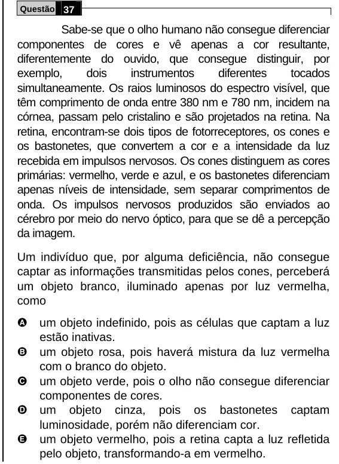

Texto extraído (pode conter ruído)

Questão 37  
Sabe-se que o olho humano não consegue diferenciar  
componentes de cores e vê apenas a cor resultante,  
diferentemente do ouvido, que consegue distinguir, por  
exemplo,  
dois  
instrumentos  
diferentes  
tocados  
simultaneamente. Os raios luminosos do espectro visível, que  
têm comprimento de onda entre 380 nm e 780 nm, incidem na  
córnea, passam pelo cristalino e são projetados na retina. Na  
retina, encontram-se dois tipos de fotorreceptores, os cones e  
os bastonetes, que convertem a cor e a intensidade da luz  
recebida em impulsos nervosos. Os cones distinguem as cores  
primárias: vermelho, verde e azul, e os bastonetes diferenciam  
apenas níveis de intensidade, sem separar comprimentos de  
onda. Os impulsos nervosos produzidos são enviados ao  
cérebro por meio do nervo óptico, para que se dê a percepção  
da imagem.  
Um indivíduo que, por alguma deficiência, não consegue  
captar as informações transmitidas pelos cones, perceberá  
um objeto branco, iluminado apenas por luz vermelha,  
como  
A  
um objeto indefinido, pois as células que captam a luz  
estão inativas.  
B  
um objeto rosa, pois haverá mistura da luz vermelha  
com o branco do objeto.  
C  
um objeto verde, pois o olho não consegue diferenciar  
componentes de cores.  
D  
um objeto cinza, pois os bastonetes captam  
luminosidade, porém não diferenciam cor.  
E  
um objeto vermelho, pois a retina capta a luz refletida  
pelo objeto, transformando-a em vermelho.

