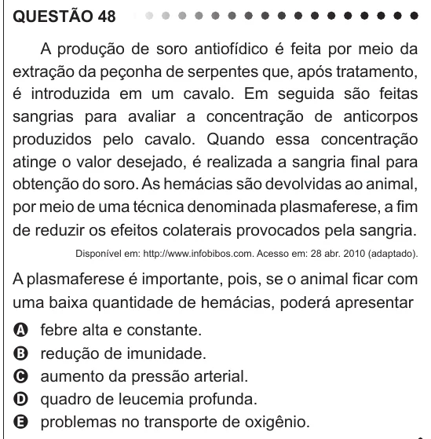

Texto extraído (pode conter ruído)

QUESTÃO 48  
A produção de soro antiofídico é feita por meio da  
extração da peçonha de serpentes que, após tratamento,  
é introduzida em um cavalo. Em seguida são feitas  
sangrias para avaliar a concentração de anticorpos  
produzidos pelo cavalo. Quando essa concentração  
atinge o valor desejado, é realizada a sangria final para  
obtenção do soro. As hemácias são devolvidas ao animal,  
por meio de uma técnica denominada plasmaferese, a fim  
de reduzir os efeitos colaterais provocados pela sangria.  
Disponível em: http://www.infobibos.com. Acesso em: 28 abr. 2010 (adaptado).  
A plasmaferese é importante, pois, se o animal ficar com  
uma baixa quantidade de hemácias, poderá apresentar  
febre alta e constante.  
A  
B  
redução de imunidade.  
aumento da pressão arterial.  
C  
quadro de leucemia profunda.  
D  
E  
problemas no transporte de oxigênio.

