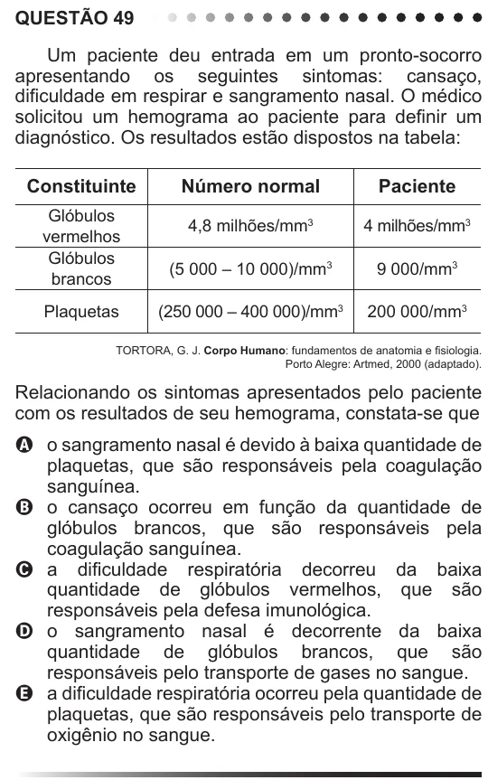

Texto extraído (pode conter ruído)

QUESTÃO 49  
Um paciente deu entrada em um pronto-socorro  
apresentando os seguintes sintomas: cansaço,  
dificuldade em respirar e sangramento nasal. O médico  
solicitou um hemograma ao paciente para definir um  
diagnóstico. Os resultados estão dispostos na tabela:  
Constituinte  
Número normal  
Paciente  
Glóbulos  
4,8 milhões/mm 3  
4 milhões/mm 3  
vermelhos  
Glóbulos  
(5 000 – 10 000)/mm 3  
9 000/mm 3  
brancos  
Plaquetas  
(250 000 – 400 000)/mm 3  
200 000/mm 3  
TORTORA, G. J. Corpo Humano: fundamentos de anatomia e fisiologia.  
Porto Alegre: Artmed, 2000 (adaptado).  
Relacionando os sintomas apresentados pelo paciente  
com os resultados de seu hemograma, constata-se que  
A o sangramento nasal é devido à baixa quantidade de  
plaquetas, que são responsáveis pela coagulação  
sanguínea.  
B o cansaço ocorreu em função da quantidade de  
glóbulos brancos, que são responsáveis pela  
coagulação sanguínea.  
C a dificuldade respiratória decorreu da baixa  
quantidade de glóbulos vermelhos, que são  
responsáveis pela defesa imunológica.  
D o sangramento nasal é decorrente da baixa  
quantidade de glóbulos brancos, que são  
responsáveis pelo transporte de gases no sangue.  
E a dificuldade respiratória ocorreu pela quantidade de  
plaquetas, que são responsáveis pelo transporte de  
oxigênio no sangue.

