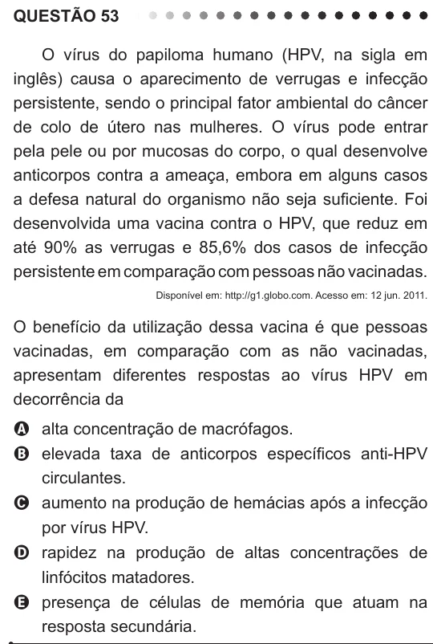

Texto extraído (pode conter ruído)

QUESTÃO 53  
O vírus do papiloma humano (HPV, na sigla em  
inglês) causa o aparecimento de verrugas e infecção  
persistente, sendo o principal fator ambiental do câncer  
de colo de útero nas mulheres. O vírus pode entrar  
pela pele ou por mucosas do corpo, o qual desenvolve  
anticorpos contra a ameaça, embora em alguns casos  
a defesa natural do organismo não seja suficiente. Foi  
desenvolvida uma vacina contra o HPV, que reduz em  
até 90% as verrugas e 85,6% dos casos de infecção  
persistente em comparação com pessoas não vacinadas.  
Disponível em: http://g1.globo.com. Acesso em: 12 jun. 2011.  
O benefício da utilização dessa vacina é que pessoas  
vacinadas, em comparação com as não vacinadas,  
apresentam diferentes respostas ao vírus HPV em  
decorrência da  
A alta concentração de macrófagos.  
B elevada taxa de anticorpos específicos anti-HPV  
circulantes.  
C aumento na produção de hemácias após a infecção  
por vírus HPV.  
D rapidez na produção de altas concentrações de  
linfócitos matadores.  
E presença de células de memória que atuam na  
resposta secundária.

