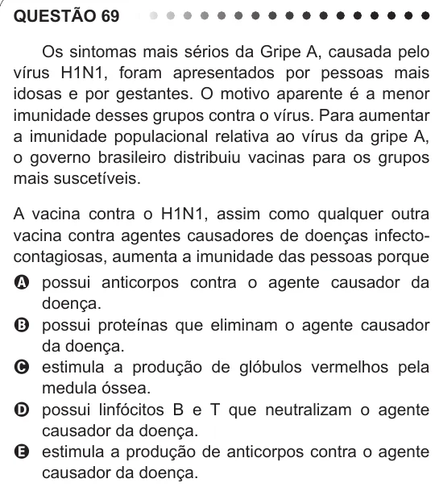

Texto extraído (pode conter ruído)

QUESTÃO 69  
Os sintomas mais sérios da Gripe A, causada pelo  
vírus H1N1, foram apresentados por pessoas mais  
idosas e por gestantes. O motivo aparente é a menor  
imunidade desses grupos contra o vírus. Para aumentar  
a imunidade populacional relativa ao vírus da gripe A,  
o governo brasileiro distribuiu vacinas para os grupos  
mais suscetíveis.  
A vacina contra o H1N1, assim como qualquer outra  
vacina contra agentes causadores de doenças infecto-  
contagiosas, aumenta a imunidade das pessoas porque  
A possui anticorpos contra o agente causador da  
doença.  
B possui proteínas que eliminam o agente causador  
da doença.  
C estimula a produção de glóbulos vermelhos pela  
medula óssea.  
D possui linfócitos B e T que neutralizam o agente  
causador da doença.  
E estimula a produção de anticorpos contra o agente  
causador da doença.

