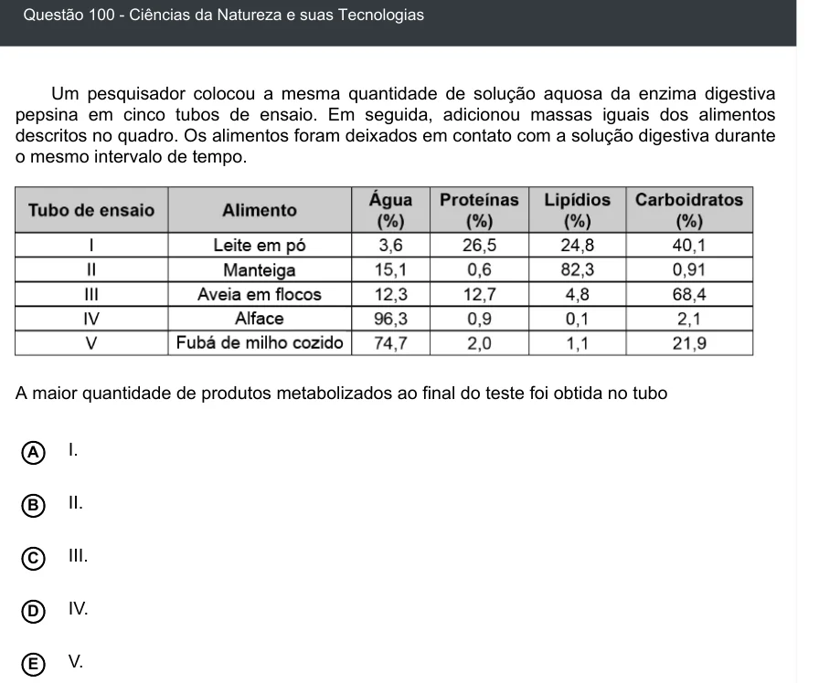

Texto extraído (pode conter ruído)

Questão 100 - Ciências da Natureza e suas Tecnologias  
Um pesquisador colocou a mesma quantidade de solução aquosa da enzima digestiva  
pepsina em cinco tubos de ensaio. Em seguida, adicionou massas iguais dos alimentos  
descritos no quadro. Os alimentos foram deixados em contato com a solução digestiva durante  
o mesmo intervalo de tempo.  
A maior quantidade de produtos metabolizados ao final do teste foi obtida no tubo  
I.  
A  
II.  
B  
C  
III.  
IV.  
D  
V.  
E

