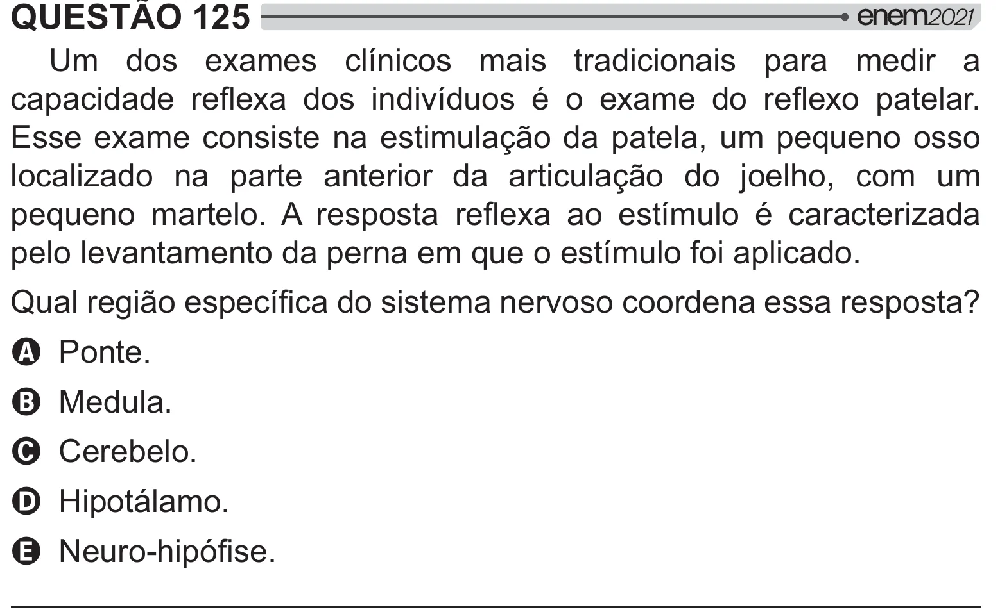

Texto extraído (pode conter ruído)

QUESTÃO 125  
Um dos exames clínicos mais tradicionais para medir a  
#   } *   "{   <  *    } * # !  
Esse exame consiste na estimulação da patela, um pequeno osso  
localizado na parte anterior da articulação do joelho, com um  
#  
  !   #   } *   
{  <    
pelo levantamento da perna em que o estímulo foi aplicado.  
&  [  
# {   
 "    
  
# ]  
A Ponte.  
B Medula.  
C Cerebelo.  
D Hipotálamo.  
E ˆ  
$#ƒ  
!

