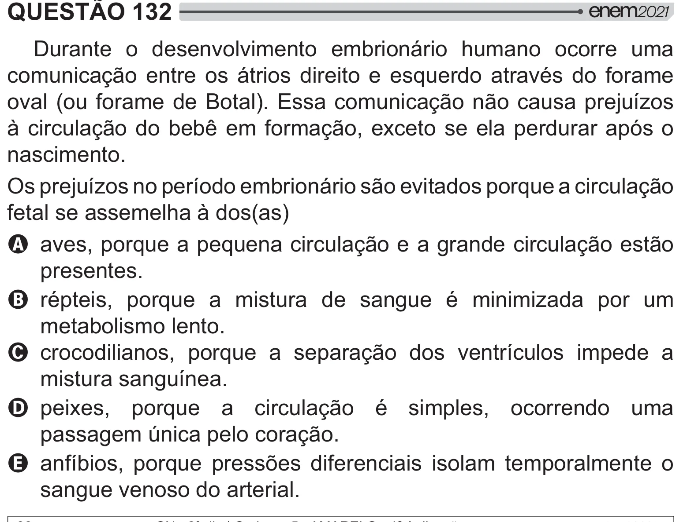

Texto extraído (pode conter ruído)

QUESTÃO 132  
Durante o desenvolvimento embrionário humano ocorre uma  
comunicação entre os átrios direito e esquerdo através do forame  
oval (ou forame de Botal). Essa comunicação não causa prejuízos  
à circulação do bebê em formação, exceto se ela perdurar após o  
nascimento.  
Os prejuízos no período embrionário são evitados porque a circulação  
fetal se assemelha à dos(as)  
A aves, porque a pequena circulação e a grande circulação estão  
presentes.  
B répteis, porque a mistura de sangue é minimizada por um  
metabolismo lento.  
C crocodilianos, porque a separação dos ventrículos impede a  
mistura sanguínea.  
D peixes, porque a circulação é simples, ocorrendo uma  
passagem única pelo coração.  
E anfíbios, porque pressões diferenciais isolam temporalmente o  
sangue venoso do arterial.

