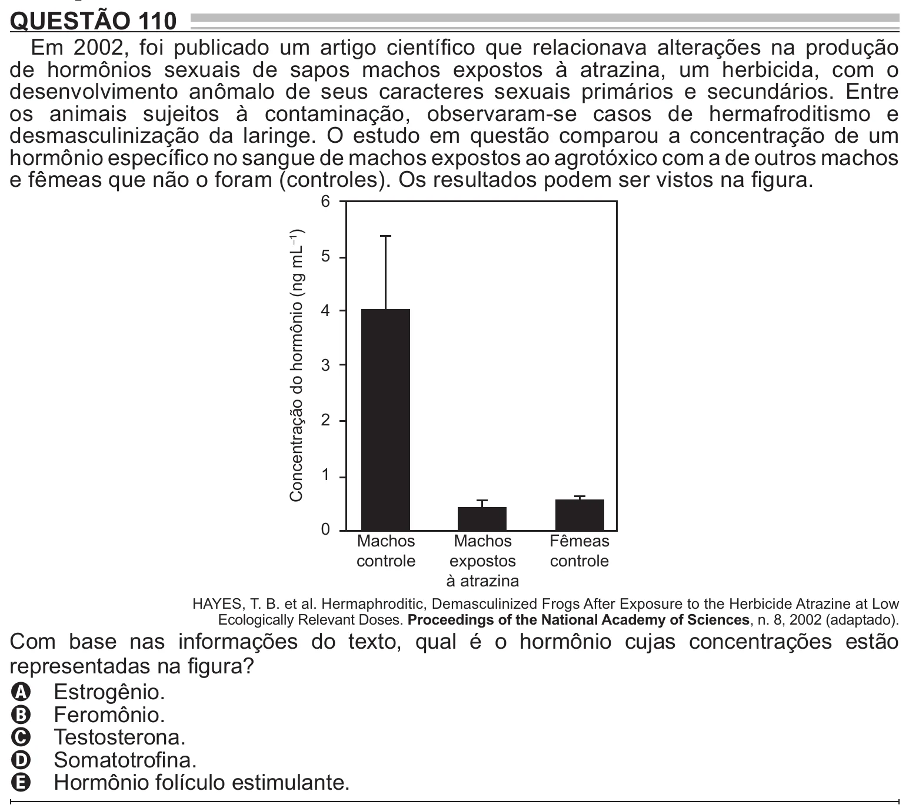

Texto extraído (pode conter ruído)

QUESTÃO 110  
Em 2002, foi publicado um artigo científico que relacionava alterações na produção  
de hormônios sexuais de sapos machos expostos à atrazina, um herbicida, com o  
desenvolvimento anômalo de seus caracteres sexuais primários e secundários. Entre  
os animais sujeitos à contaminação, observaram-se casos de hermafroditismo e  
desmasculinização da laringe. O estudo em questão comparou a concentração de um  
hormônio específico no sangue de machos expostos ao agrotóxico com a de outros machos  
e fêmeas que não o foram (controles). Os resultados podem ser vistos na figura.  
6  
Concentração do hormônio (ng mL −1 )  
5  
4  
3  
2  
1  
0  
Machos  
Machos  
Fêmeas  
controle  
expostos  
controle  
à atrazina  
HAYES, T. B. et al. Hermaphroditic, Demasculinized Frogs After Exposure to the Herbicide Atrazine at Low  
Ecologically Relevant Doses. Proceedings of the National Academy of Sciences, n. 8, 2002 (adaptado).  
Com base nas informações do texto, qual é o hormônio cujas concentrações estão  
representadas na figura?  
A Estrogênio.  
B Feromônio.  
C Testosterona.  
D Somatotrofina.  
E Hormônio folículo estimulante.

