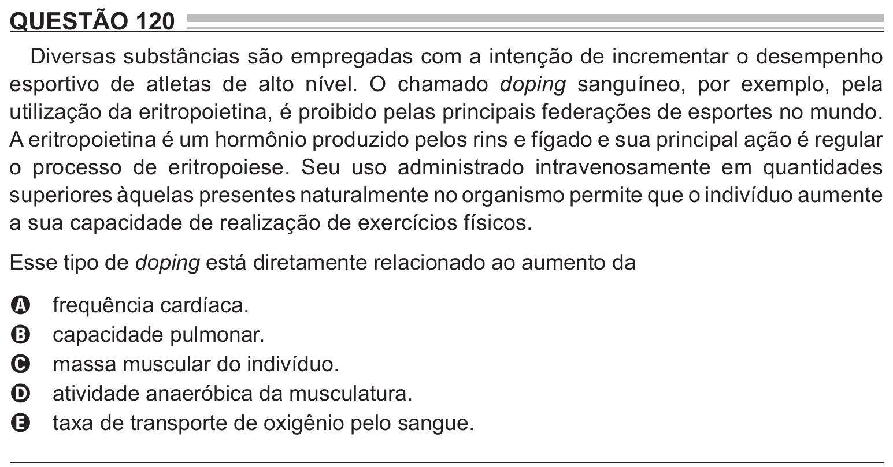

Texto extraído (pode conter ruído)

QUESTÃO 120  
Diversas substâncias são empregadas com a intenção de incrementar o desempenho  
esportivo de atletas de alto nível. O chamado doping sanguíneo, por exemplo, pela  
utilização da eritropoietina, é proibido pelas principais federações de esportes no mundo.  
A eritropoietina é um hormônio produzido pelos rins e fígado e sua principal ação é regular  
o processo de eritropoiese. Seu uso administrado intravenosamente em quantidades  
superiores àquelas presentes naturalmente no organismo permite que o indivíduo aumente  
a sua capacidade de realização de exercícios físicos.  
Esse tipo de doping está diretamente relacionado ao aumento da  
frequência cardíaca.  
A  
capacidade pulmonar.  
B  
massa muscular do indivíduo.  
C  
atividade anaeróbica da musculatura.  
D  
taxa de transporte de oxigênio pelo sangue.  
E

