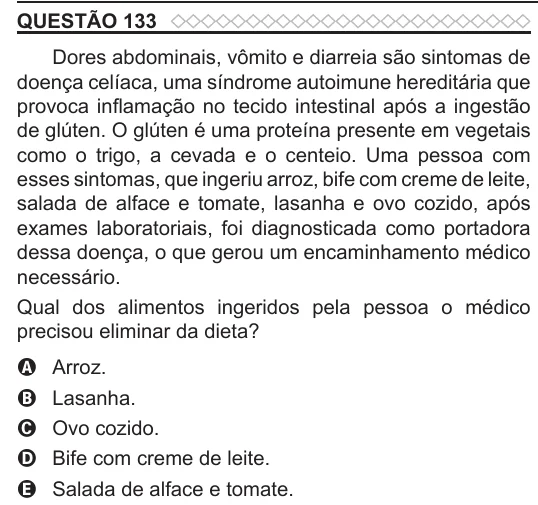

Texto extraído (pode conter ruído)

QUESTÃO 133  
Dores abdominais, vômito e diarreia são sintomas de  
doença celíaca, uma síndrome autoimune hereditária que  
provoca inflamação no tecido intestinal após a ingestão  
de glúten. O glúten é uma proteína presente em vegetais  
como o trigo, a cevada e o centeio. Uma pessoa com  
esses sintomas, que ingeriu arroz, bife com creme de leite,  
salada de alface e tomate, lasanha e ovo cozido, após  
exames laboratoriais, foi diagnosticada como portadora  
dessa doença, o que gerou um encaminhamento médico  
necessário.  
Qual dos alimentos ingeridos pela pessoa o médico  
precisou eliminar da dieta?  
Arroz.  
A  
Lasanha.  
B  
Ovo cozido.  
C  
D  
Bife com creme de leite.  
Salada de alface e tomate.  
E

