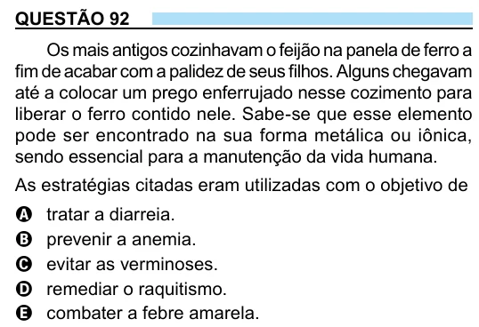

Texto extraído (pode conter ruído)

QUESTÃO 92  
Os mais antigos cozinhavam o feijão na panela de ferro a  
fim de acabar com a palidez de seus filhos. Alguns chegavam  
até a colocar um prego enferrujado nesse cozimento para  
liberar o ferro contido nele. Sabe-se que esse elemento  
pode ser encontrado na sua forma metálica ou iônica,  
sendo essencial para a manutenção da vida humana.  
As estratégias citadas eram utilizadas com o objetivo de  
A  
tratar a diarreia.  
prevenir a anemia.  
B  
C  
evitar as verminoses.  
remediar o raquitismo.  
D  
combater a febre amarela.  
E

