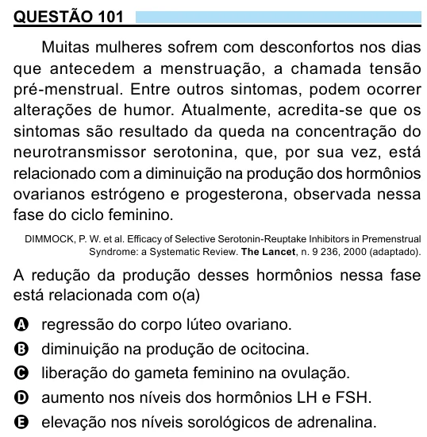

Texto extraído (pode conter ruído)

QUESTÃO 101  
Muitas mulheres sofrem com desconfortos nos dias  
que antecedem a menstruação, a chamada tensão  
pré-menstrual. Entre outros sintomas, podem ocorrer  
alterações de humor. Atualmente, acredita-se que os  
sintomas são resultado da queda na concentração do  
neurotransmissor serotonina, que, por sua vez, está  
relacionado com a diminuição na produção dos hormônios  
ovarianos estrógeno e progesterona, observada nessa  
fase do ciclo feminino.  
DIMMOCK, P. W. et al. Efficacy of Selective Serotonin-Reuptake Inhibitors in Premenstrual  
Syndrome: a Systematic Review. The Lancet, n. 9 236, 2000 (adaptado).  
A redução da produção desses hormônios nessa fase  
está relacionada com o(a)  
A regressão do corpo lúteo ovariano.  
B diminuição na produção de ocitocina.  
C liberação do gameta feminino na ovulação.  
D aumento nos níveis dos hormônios LH e FSH.  
E elevação nos níveis sorológicos de adrenalina.

