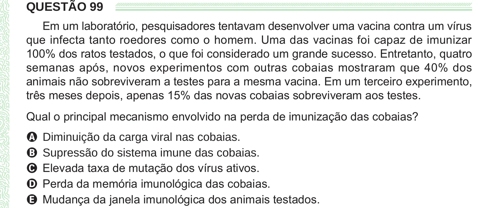

Texto extraído (pode conter ruído)

QUESTÃO 99  
Em um laboratório, pesquisadores tentavam desenvolver uma vacina contra um vírus  
que infecta tanto roedores como o homem. Uma das vacinas foi capaz de imunizar  
100% dos ratos testados, o que foi considerado um grande sucesso. Entretanto, quatro  
semanas após, novos experimentos com outras cobaias mostraram que 40% dos  
animais não sobreviveram a testes para a mesma vacina. Em um terceiro experimento,  
três meses depois, apenas 15% das novas cobaias sobreviveram aos testes.  
Qual o principal mecanismo envolvido na perda de imunização das cobaias?  
A Diminuição da carga viral nas cobaias.  
B Supressão do sistema imune das cobaias.  
C Elevada taxa de mutação dos vírus ativos.  
D Perda da memória imunológica das cobaias.  
E Mudança da janela imunológica dos animais testados.

