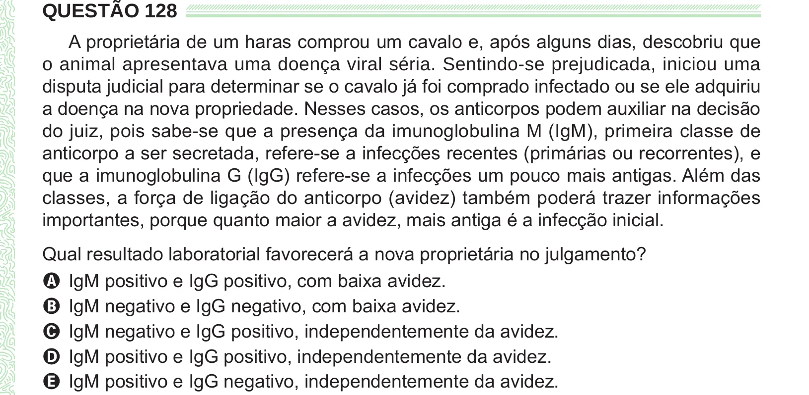

Texto extraído (pode conter ruído)

QUESTÃO 128  
A proprietária de um haras comprou um cavalo e, após alguns dias, descobriu que  
o animal apresentava uma doença viral séria. Sentindo-se prejudicada, iniciou uma  
disputa judicial para determinar se o cavalo já foi comprado infectado ou se ele adquiriu  
a doença na nova propriedade. Nesses casos, os anticorpos podem auxiliar na decisão  
do juiz, pois sabe-se que a presença da imunoglobulina M (IgM), primeira classe de  
anticorpo a ser secretada, refere-se a infecções recentes (primárias ou recorrentes), e  
que a imunoglobulina G (IgG) refere-se a infecções um pouco mais antigas. Além das  
classes, a força de ligação do anticorpo (avidez) também poderá trazer informações  
importantes, porque quanto maior a avidez, mais antiga é a infecção inicial.  
Qual resultado laboratorial favorecerá a nova proprietária no julgamento?  
A IgM positivo e IgG positivo, com baixa avidez.  
B IgM negativo e IgG negativo, com baixa avidez.  
C IgM negativo e IgG positivo, independentemente da avidez.  
D IgM positivo e IgG positivo, independentemente da avidez.  
E IgM positivo e IgG negativo, independentemente da avidez.

