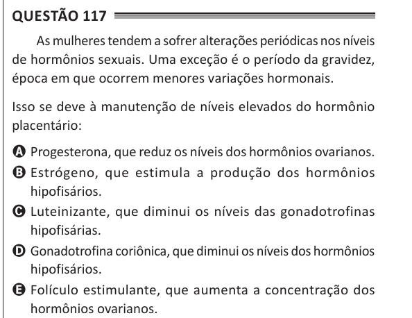

Texto extraído (pode conter ruído)

Questão 117  
As mulheres tendem a sofrer alterações periódicas nos níveis  
de hormônios sexuais. Uma exceção é o período da gravidez,  
época em que ocorrem menores variações hormonais.  
Isso se deve à manutenção de níveis elevados do hormônio  
placentário:  
A Progesterona, que reduz os níveis dos hormônios ovarianos.  
B Estrógeno, que estimula a produção dos hormônios  
hipofisários.  
C Luteinizante, que diminui os níveis das gonadotrofinas  
hipofisárias.  
D Gonadotrofina coriônica, que diminui os níveis dos hormônios  
hipofisários.  
E Folículo estimulante, que aumenta a concentração dos  
hormônios ovarianos.

