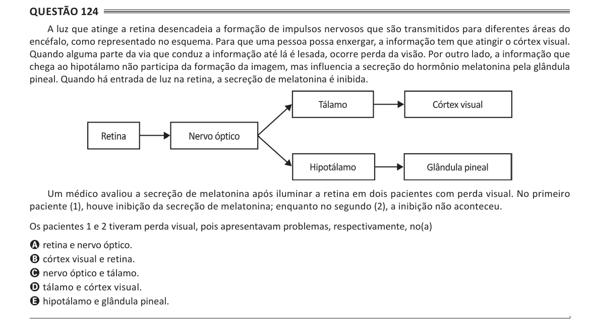

Texto extraído (pode conter ruído)

Questão 124  
A luz que atinge a retina desencadeia a formação de impulsos nervosos que são transmitidos para diferentes áreas do  
encéfalo, como representado no esquema. Para que uma pessoa possa enxergar, a informação tem que atingir o córtex visual.  
Quando alguma parte da via que conduz a informação até lá é lesada, ocorre perda da visão. Por outro lado, a informação que  
chega ao hipotálamo não participa da formação da imagem, mas influencia a secreção do hormônio melatonina pela glândula  
pineal. Quando há entrada de luz na retina, a secreção de melatonina é inibida.  
Um médico avaliou a secreção de melatonina após iluminar a retina em dois pacientes com perda visual. No primeiro  
paciente (1), houve inibição da secreção de melatonina; enquanto no segundo (2), a inibição não aconteceu.  
Os pacientes 1 e 2 tiveram perda visual, pois apresentavam problemas, respectivamente, no(a)  
A retina e nervo óptico.  
B córtex visual e retina.  
C nervo óptico e tálamo.  
D tálamo e córtex visual.  
E hipotálamo e glândula pineal.

