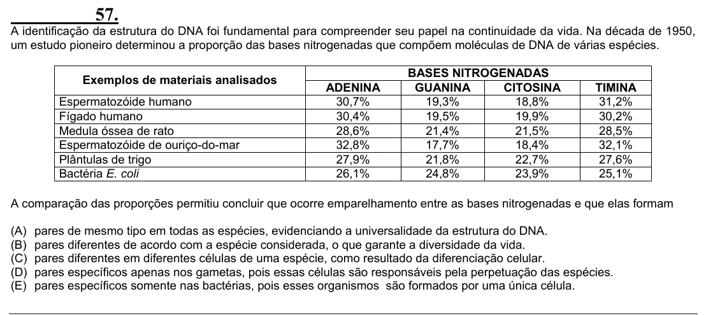

Texto extraído (pode conter ruído)

57.  
A identificação da estrutura do DNA foi fundamental para compreender seu papel na continuidade da vida. Na década de 1950,  
um estudo pioneiro determinou a proporção das bases nitrogenadas que compõem moléculas de DNA de várias espécies.  
BASES NITROGENADAS  
Exemplos de materiais analisados  
ADENINA  
GUANINA  
CITOSINA  
TIMINA  
Espermatozóide humano  
30,7%  
19,3%  
18,8%  
31,2%  
Fígado humano  
30,4%  
19,5%  
19,9%  
30,2%  
Medula óssea de rato  
28,6%  
21,4%  
21,5%  
28,5%  
Espermatozóide de ouriço-do-mar  
32,8%  
17,7%  
18,4%  
32,1%  
Plântulas de trigo  
27,9%  
21,8%  
22,7%  
27,6%  
Bactéria E. coli  
26,1%  
24,8%  
23,9%  
25,1%  
A comparação das proporções permitiu concluir que ocorre emparelhamento entre as bases nitrogenadas e que elas formam  
(A) pares de mesmo tipo em todas as espécies, evidenciando a universalidade da estrutura do DNA.  
(B) pares diferentes de acordo com a espécie considerada, o que garante a diversidade da vida.  
(C) pares diferentes em diferentes células de uma espécie, como resultado da diferenciação celular.  
(D) pares específicos apenas nos gametas, pois essas células são responsáveis pela perpetuação das espécies.  
(E) pares específicos somente nas bactérias, pois esses organismos são formados por uma única célula.

