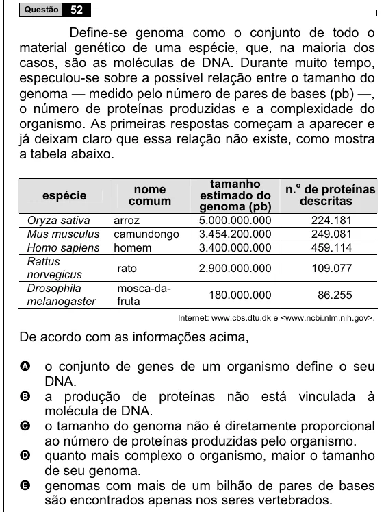

Texto extraído (pode conter ruído)

52  
Questão  
Define-se genoma como o conjunto de todo o  
material genético de uma espécie, que, na maioria dos  
casos, são as moléculas de DNA. Durante muito tempo,  
especulou-se sobre a possível relação entre o tamanho do  
genoma — medido pelo número de pares de bases (pb) —,  
o número de proteínas produzidas e a complexidade do  
organismo. As primeiras respostas começam a aparecer e  
já deixam claro que essa relação não existe, como mostra  
a tabela abaixo.  
tamanho  
nome  
n. o de proteínas  
espécie  
estimado do  
comum  
descritas  
genoma (pb)  
arroz  
5.000.000.000  
224.181  
Oryza sativa  
Mus musculus  
camundongo  
3.454.200.000  
249.081  
Homo sapiens  
homem  
3.400.000.000  
459.114  
Rattus  
rato  
2.900.000.000  
109.077  
norvegicus  
mosca-da-  
Drosophila  
180.000.000  
86.255  
fruta  
melanogaster  
Internet: www.cbs.dtu.dk e <www.ncbi.nlm.nih.gov>.  
De acordo com as informações acima,  
o conjunto de genes de um organismo define o seu  
A  
DNA.  
a produção de proteínas não está vinculada à  
B  
molécula de DNA.  
o tamanho do genoma não é diretamente proporcional  
C  
ao número de proteínas produzidas pelo organismo.  
quanto mais complexo o organismo, maior o tamanho  
D  
de seu genoma.  
genomas com mais de um bilhão de pares de bases  
E  
são encontrados apenas nos seres vertebrados.

