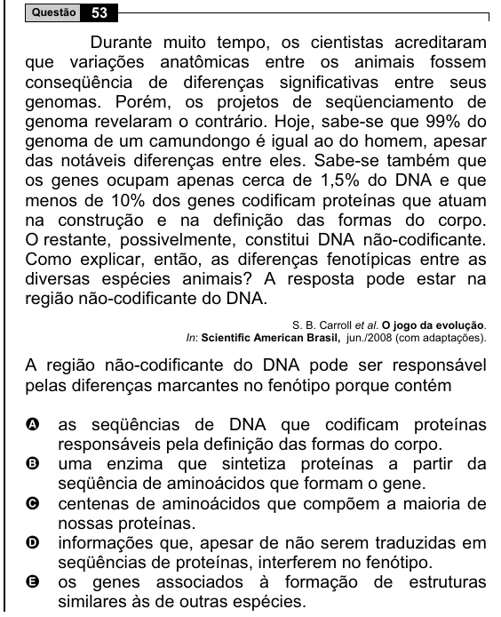

Texto extraído (pode conter ruído)

Questão  
53  
Durante muito tempo, os cientistas acreditaram  
que variações anatômicas entre os animais fossem  
conseqüência de diferenças significativas entre seus  
genomas. Porém, os projetos de seqüenciamento de  
genoma revelaram o contrário. Hoje, sabe-se que 99% do  
genoma de um camundongo é igual ao do homem, apesar  
das notáveis diferenças entre eles. Sabe-se também que  
os genes ocupam apenas cerca de 1,5% do DNA e que  
menos de 10% dos genes codificam proteínas que atuam  
na construção e na definição das formas do corpo.  
O restante, possivelmente, constitui DNA não-codificante.  
Como explicar, então, as diferenças fenotípicas entre as  
diversas espécies animais? A resposta pode estar na  
região não-codificante do DNA.  
S. B. Carroll et al. O jogo da evolução.  
In: Scientific American Brasil, jun./2008 (com adaptações).  
A região não-codificante do DNA pode ser responsável  
pelas diferenças marcantes no fenótipo porque contém  
as seqüências de DNA que codificam proteínas  
A  
responsáveis pela definição das formas do corpo.  
uma enzima que sintetiza proteínas a partir da  
B  
seqüência de aminoácidos que formam o gene.  
C  
centenas de aminoácidos que compõem a maioria de  
nossas proteínas.  
D  
informações que, apesar de não serem traduzidas em  
seqüências de proteínas, interferem no fenótipo.  
E  
os genes associados à formação de estruturas  
similares às de outras espécies.

