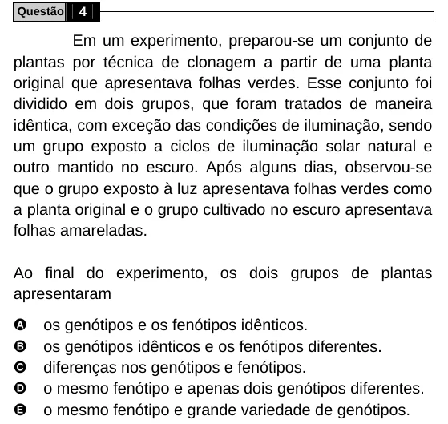

Texto extraído (pode conter ruído)

Questão  
4  
Em um experimento, preparou-se um conjunto de  
plantas por técnica de clonagem a partir de uma planta  
original que apresentava folhas verdes. Esse conjunto foi  
dividido em dois grupos, que foram tratados de maneira  
idêntica, com exceção das condições de iluminação, sendo  
um grupo exposto a ciclos de iluminação solar natural e  
outro mantido no escuro. Após alguns dias, observou-se  
que o grupo exposto à luz apresentava folhas verdes como  
a planta original e o grupo cultivado no escuro apresentava  
folhas amareladas.  
Ao final do experimento, os dois grupos de plantas  
apresentaram  
A  
os genótipos e os fenótipos idênticos.  
B  
os genótipos idênticos e os fenótipos diferentes.  
C  
diferenças nos genótipos e fenótipos.  
D  
o mesmo fenótipo e apenas dois genótipos diferentes.  
E  
o mesmo fenótipo e grande variedade de genótipos.

