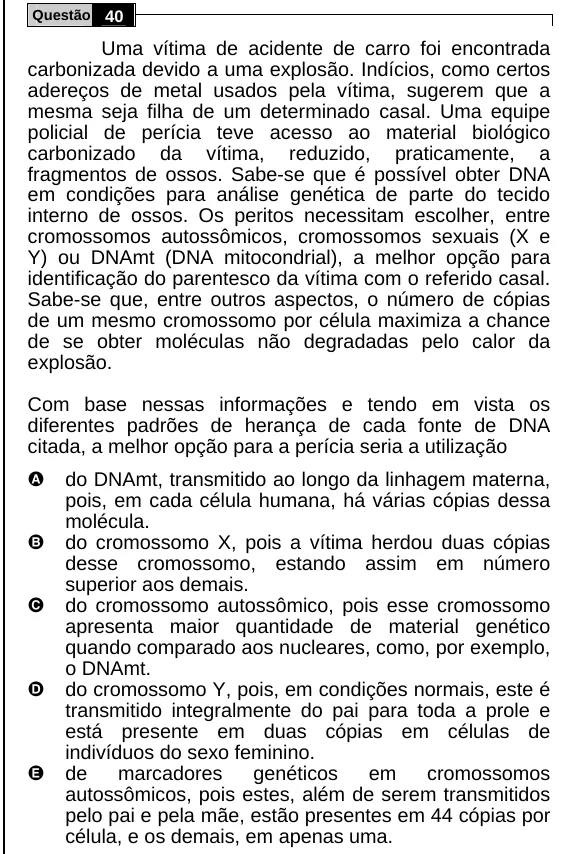

Texto extraído (pode conter ruído)

Questão 40  
Uma vítima de acidente de carro foi encontrada  
carbonizada devido a uma explosão. Indícios, como certos  
adereços de metal usados pela vítima, sugerem que a  
mesma seja filha de um determinado casal. Uma equipe  
policial de perícia teve acesso ao material biológico  
carbonizado da vítima, reduzido, praticamente, a  
fragmentos de ossos. Sabe-se que é possível obter DNA  
em condições para análise genética de parte do tecido  
interno de ossos. Os peritos necessitam escolher, entre  
cromossomos autossômicos, cromossomos sexuais (X e  
Y) ou DNAmt (DNA mitocondrial), a melhor opção para  
identificação do parentesco da vítima com o referido casal.  
Sabe-se que, entre outros aspectos, o número de cópias  
de um mesmo cromossomo por célula maximiza a chance  
de se obter moléculas não degradadas pelo calor da  
explosão.  
Com base nessas informações e tendo em vista os  
diferentes padrões de herança de cada fonte de DNA  
citada, a melhor opção para a perícia seria a utilização  
A  
do DNAmt, transmitido ao longo da linhagem materna,  
pois, em cada célula humana, há várias cópias dessa  
molécula.  
B  
do cromossomo X, pois a vítima herdou duas cópias  
desse cromossomo, estando assim em número  
superior aos demais.  
C  
do cromossomo autossômico, pois esse cromossomo  
apresenta maior quantidade de material genético  
quando comparado aos nucleares, como, por exemplo,  
o DNAmt.  
D  
do cromossomo Y, pois, em condições normais, este é  
transmitido integralmente do pai para toda a prole e  
está presente em duas cópias em células de  
indivíduos do sexo feminino.  
E  
de  
marcadores  
genéticos  
em  
cromossomos  
autossômicos, pois estes, além de serem transmitidos  
pelo pai e pela mãe, estão presentes em 44 cópias por  
célula, e os demais, em apenas uma.

