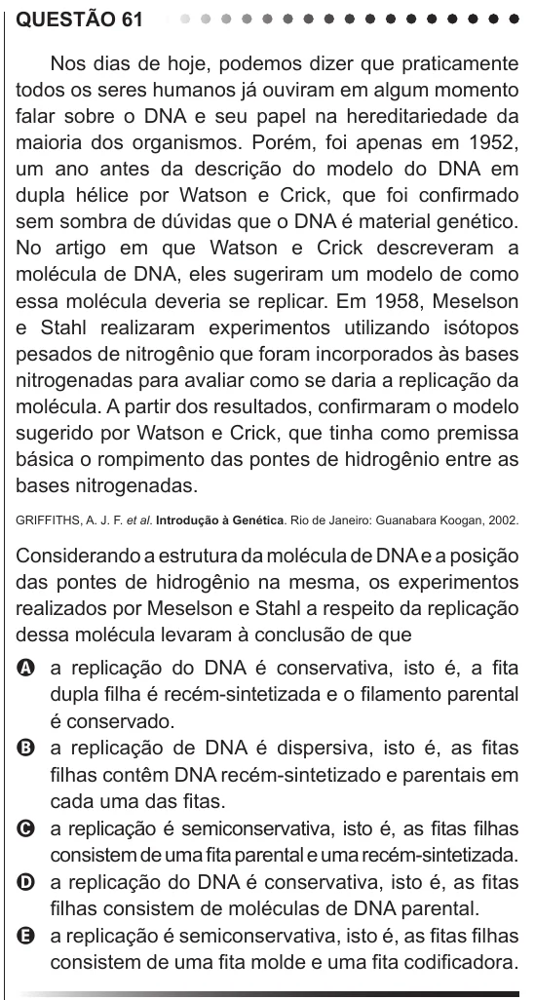

Texto extraído (pode conter ruído)

QUESTÃO 61  
Nos dias de hoje, podemos dizer que praticamente  
todos os seres humanos já ouviram em algum momento  
falar sobre o DNA e seu papel na hereditariedade da  
maioria dos organismos. Porém, foi apenas em 1952,  
um ano antes da descrição do modelo do DNA em  
dupla hélice por Watson e Crick, que foi confirmado  
sem sombra de dúvidas que o DNA é material genético.  
No artigo em que Watson e Crick descreveram a  
molécula de DNA, eles sugeriram um modelo de como  
essa molécula deveria se replicar. Em 1958, Meselson  
e Stahl realizaram experimentos utilizando isótopos  
pesados de nitrogênio que foram incorporados às bases  
nitrogenadas para avaliar como se daria a replicação da  
molécula. A partir dos resultados, confirmaram o modelo  
sugerido por Watson e Crick, que tinha como premissa  
básica o rompimento das pontes de hidrogênio entre as  
bases nitrogenadas.  
GRIFFITHS, A. J. F. et al. Introdução à Genética. Rio de Janeiro: Guanabara Koogan, 2002.  
Considerando a estrutura da molécula de DNA e a posição  
das pontes de hidrogênio na mesma, os experimentos  
realizados por Meselson e Stahl a respeito da replicação  
dessa molécula levaram à conclusão de que  
A a replicação do DNA é conservativa, isto é, a fita  
dupla filha é recém-sintetizada e o filamento parental  
é conservado.  
B a replicação de DNA é dispersiva, isto é, as fitas  
filhas contêm DNA recém-sintetizado e parentais em  
cada uma das fitas.  
C a replicação é semiconservativa, isto é, as fitas filhas  
consistem de uma fita parental e uma recém-sintetizada.  
D a replicação do DNA é conservativa, isto é, as fitas  
filhas consistem de moléculas de DNA parental.  
E a replicação é semiconservativa, isto é, as fitas filhas  
consistem de uma fita molde e uma fita codificadora.

