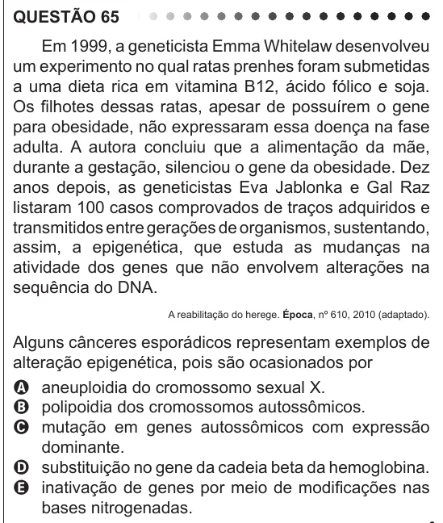

Texto extraído (pode conter ruído)

QUESTÃO 65  
Em 1999, a geneticista Emma Whitelaw desenvolveu  
um experimento no qual ratas prenhes foram submetidas  
a uma dieta rica em vitamina B12, ácido fólico e soja.  
Os filhotes dessas ratas, apesar de possuírem o gene  
para obesidade, não expressaram essa doença na fase  
adulta. A autora concluiu que a alimentação da mãe,  
durante a gestação, silenciou o gene da obesidade. Dez  
anos depois, as geneticistas Eva Jablonka e Gal Raz  
listaram 100 casos comprovados de traços adquiridos e  
transmitidos entre gerações de organismos, sustentando,  
assim, a epigenética, que estuda as mudanças na  
atividade dos genes que não envolvem alterações na  
sequência do DNA.  
A reabilitação do herege. Época, nº 610, 2010 (adaptado).  
Alguns cânceres esporádicos representam exemplos de  
alteração epigenética, pois são ocasionados por  
A aneuploidia do cromossomo sexual X.  
B polipoidia dos cromossomos autossômicos.  
C mutação em genes autossômicos com expressão  
dominante.  
D substituição no gene da cadeia beta da hemoglobina.  
E inativação de genes por meio de modificações nas  
bases nitrogenadas.

