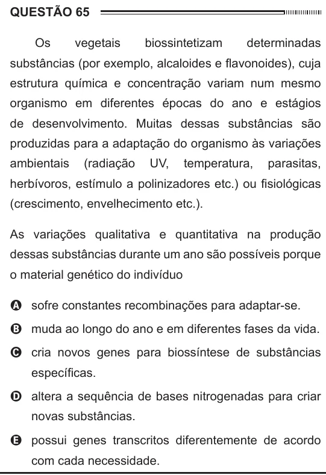

Texto extraído (pode conter ruído)

QUESTÃO 65  
Os  
vegetais  
biossintetizam  
determinadas  
substâncias (por exemplo, alcaloides e flavonoides), cuja  
estrutura química e concentração variam num mesmo  
organismo em diferentes épocas do ano e estágios  
de desenvolvimento. Muitas dessas substâncias são  
produzidas para a adaptação do organismo às variações  
ambientais  
(radiação  
UV,  
temperatura,  
parasitas,  
herbívoros, estímulo a polinizadores etc.) ou fisiológicas  
(crescimento, envelhecimento etc.).  
As variações qualitativa e quantitativa na produção  
dessas substâncias durante um ano são possíveis porque  
o material genético do indivíduo  
A sofre constantes recombinações para adaptar-se.  
B muda ao longo do ano e em diferentes fases da vida.  
C cria novos genes para biossíntese de substâncias  
específicas.  
D altera a sequência de bases nitrogenadas para criar  
novas substâncias.  
E possui genes transcritos diferentemente de acordo  
com cada necessidade.

