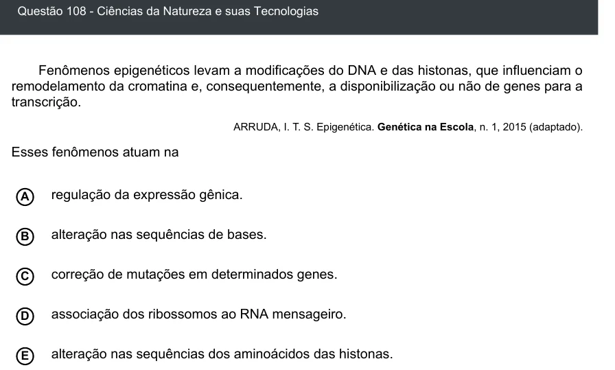

Texto extraído (pode conter ruído)

Questão 108 - Ciências da Natureza e suas Tecnologias  
Fenômenos epigenéticos levam a modificações do DNA e das histonas, que influenciam o  
remodelamento da cromatina e, consequentemente, a disponibilização ou não de genes para a  
transcrição.  
ARRUDA, I. T. S. Epigenética. Genética na Escola, n. 1, 2015 (adaptado).  
Esses fenômenos atuam na  
A  
regulação da expressão gênica.  
alteração nas sequências de bases.  
B  
correção de mutações em determinados genes.  
C  
D  
associação dos ribossomos ao RNA mensageiro.  
E  
alteração nas sequências dos aminoácidos das histonas.

