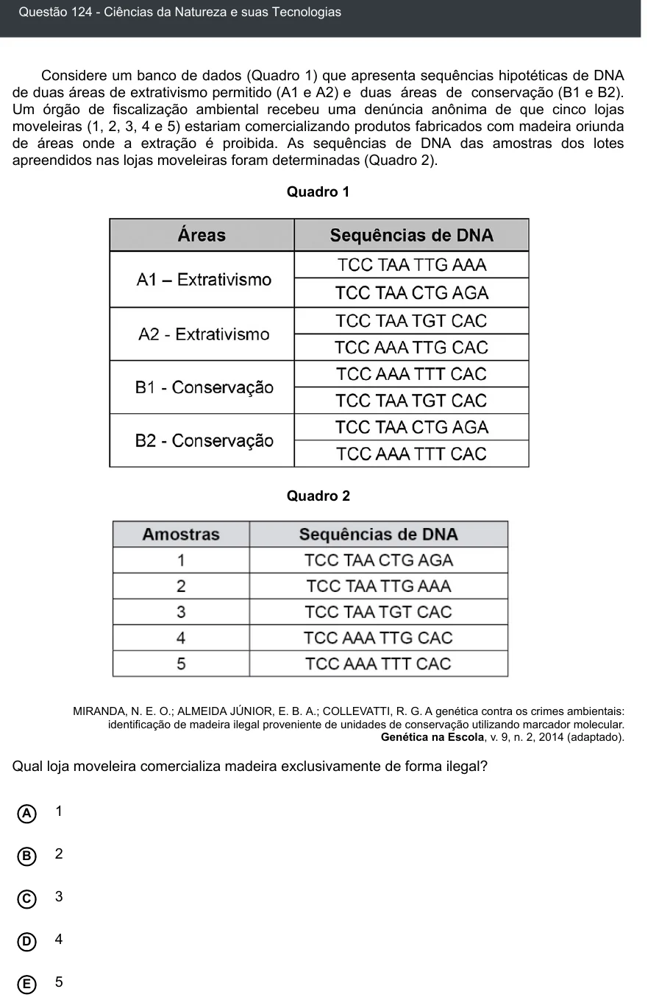

Texto extraído (pode conter ruído)

Questão 124 - Ciências da Natureza e suas Tecnologias  
Considere um banco de dados (Quadro 1) que apresenta sequências hipotéticas de DNA  
de duas áreas de extrativismo permitido (A1 e A2) e duas áreas de conservação (B1 e B2).  
Um órgão de fiscalização ambiental recebeu uma denúncia anônima de que cinco lojas  
moveleiras (1, 2, 3, 4 e 5) estariam comercializando produtos fabricados com madeira oriunda  
de áreas onde a extração é proibida. As sequências de DNA das amostras dos lotes  
apreendidos nas lojas moveleiras foram determinadas (Quadro 2).  
Quadro 1  
Quadro 2  
MIRANDA, N. E. O.; ALMEIDA JÚNIOR, E. B. A.; COLLEVATTI, R. G. A genética contra os crimes ambientais:  
identificação de madeira ilegal proveniente de unidades de conservação utilizando marcador molecular.  
Genética na Escola, v. 9, n. 2, 2014 (adaptado).  
Qual loja moveleira comercializa madeira exclusivamente de forma ilegal?  
A  
1  
2  
B  
3  
C  
4  
D  
E  
5

