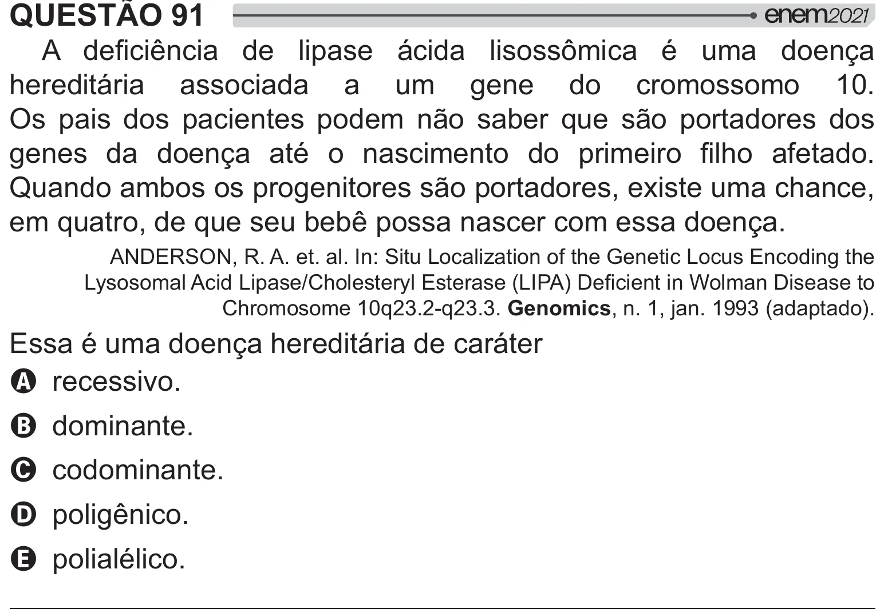

Texto extraído (pode conter ruído)

QUESTÃO 91  
  +   #  /   2 <   =  
hereditária associada a um gene do cromossomo 10.  
Os pais dos pacientes podem não saber que são portadores dos  
     =  <       #  $ > !  
Quando ambos os progenitores são portadores, existe uma chance,  
em quatro, de que seu bebê possa nascer com essa doença.  
ANDERSON, R. A. et. al. In: Situ Localization of the Genetic Locus Encoding the  
?@  ?# B$  
@  J?KW%   X%     
Chromosome 10q23.2-q23.3. Genomics, n. 1, jan. 1993 (adaptado).  
Essa é uma doença hereditária de caráter  
A recessivo.  
B dominante.  
C codominante.  
D poligênico.  
E polialélico.

