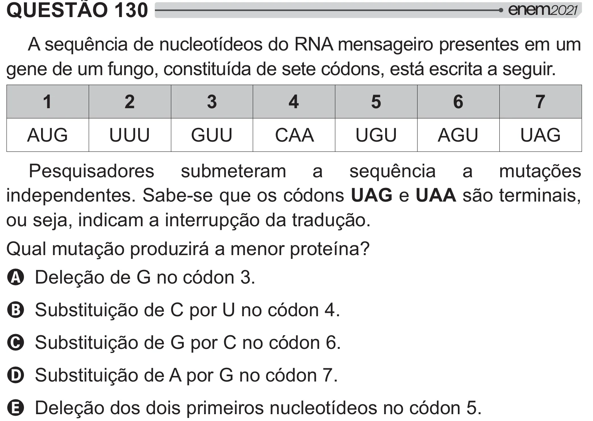

Texto extraído (pode conter ruído)

QUESTÃO 130  
A sequência de nucleotídeos do RNA mensageiro presentes em um  
gene de um fungo, constituída de sete códons, está escrita a seguir.  
1  
2  
3  
4  
5  
6  
7  
AUG  
UUU  
GUU  
CAA  
UGU  
AGU  
UAG  
Pesquisadores submeteram a sequência a mutações  
independentes. Sabe-se que os códons UAG e UAA são terminais,  
ou seja, indicam a interrupção da tradução.  
&  =[# / # {]  
A Deleção de G no códon 3.  
B Substituição de C por U no códon 4.  
C Substituição de G por C no códon 6.  
D Substituição de A por G no códon 7.  
E Deleção dos dois primeiros nucleotídeos no códon 5.

